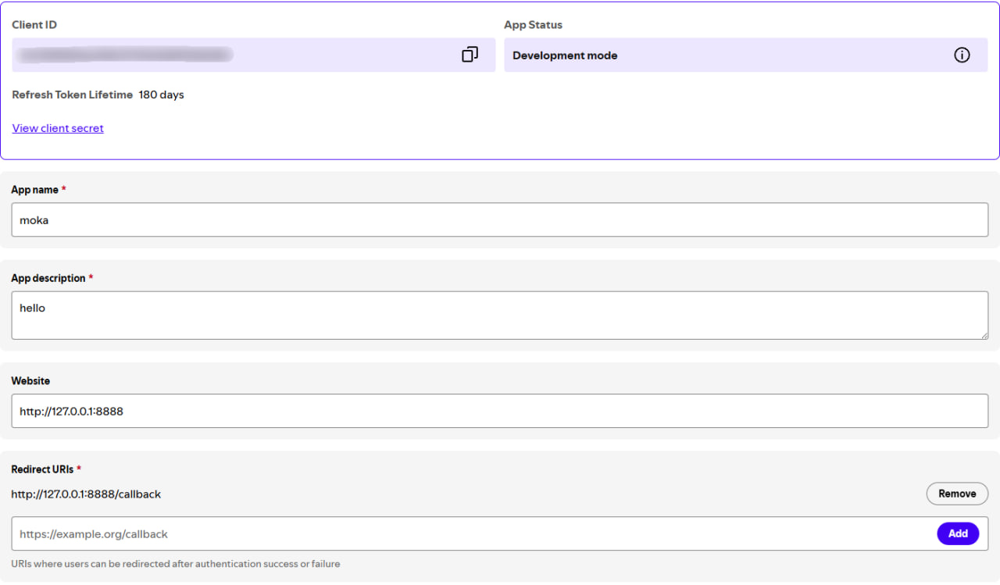
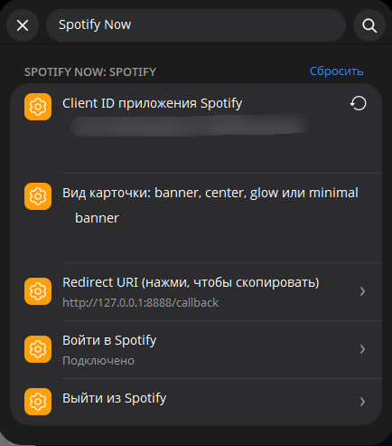
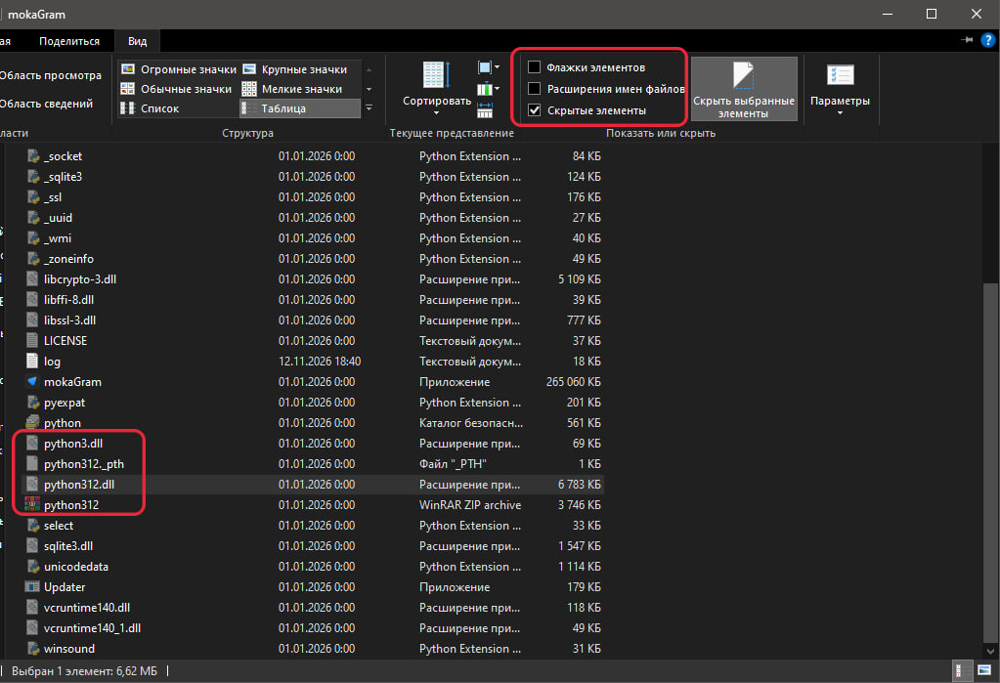

# Spotify

Плагин отправляет карточку песни которая играет у вас в Spotify в тот момент. Это тутор подключения Spotify для особо одаренных <3

## Подключение 

1. Открой [Spotify Developer Dashboard](https://developer.spotify.com/dashboard) и создай приложение (**Create app**)
2. Сначала укажи какие нибудь рандомные ссылки(ибо при создании спотик не пускает локальные ссылки)
3. Потом нажми **Edit** и туда в **Redirect URL** вставь это:

   ```
   http://127.0.0.1:8888/callback
   ```

   Нажми **Add**, потом сохрани в низу страницы.

   

4. Скопируй **Client ID** из дашборда
5. В mokaGram открой настройки плагина Spotify и там вставь **Client ID** после чего внизу нажми на подключение и подключись

   

6. Подтверди доступ в браузере. Когда появится страница "Подключен", вернись в mokaGram и там должно быть написано "Подключено"


## Из за отсутствия Pillow в сборке карта не будет создаваться. Тутор как скачать Pillow

Картинку рисует библиотека Pillow, но в папке сборки mokaGram нету этой библиотеки рядом

**1. Узнай версию встроенного Python.** Открой папку с `mokaGram.exe`, включи показ скрытых файлов (проводник → **Просмотр → Показать → Скрытые элементы**) и найди `python3NN.dll`. `python312.dll` значит Python 3.12, `python313.dll` значит 3.13 и тп



**2. Установи Pillow в папку клиента.** Нужен любой установленный Python с `pip`. В терминале выполни, подставив свою версию и свой путь:

```
pip install pillow --upgrade --target "ПУТЬ К ПАПКЕ С mokaGram" --platform win_amd64 --python-version 3.12(ТУТ ВАША ВЕРСИЯ) --only-binary=:all:
```

| Параметр | Что подставить |
|---|---|
| `--target` | папка, где лежит `mokaGram.exe` |
| `--python-version` | версия из шага 1 (`3.12` для `python312.dll`) |

**3. ** Рядом с `python312.dll` должны появиться папка `PIL` и папка `pillow-<версия>.dist-info`

**4. Перезапусти mokaGram** полностью и напиши `.now` в каком то чате

